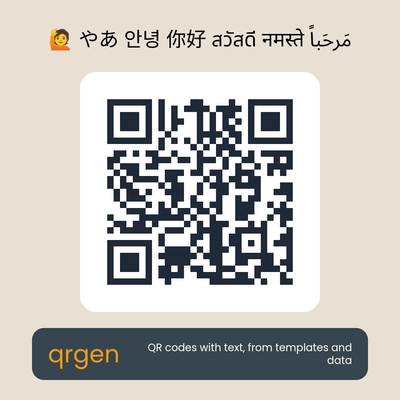

# qrgen

Generate QR code images with text, from one value or every row of a CSV file.

Layouts are [textplate](https://github.com/angkarn/textplate) templates (JSON5) with an extra `qr`
node: put QR codes, multilingual text, boxes and images anywhere on the image, and fill them with
`{{placeholders}}` from your data.

<p>
  
  
  
  
</p>

Try it in the browser: [Demo](https://qrgen-browser-demo.pages.dev)

## Install

Download a binary from [Releases](https://github.com/angkarn/qrgen/releases):

```sh
# macOS (Apple Silicon)
curl -L -o qrgen https://github.com/angkarn/qrgen/releases/latest/download/aarch64-apple-darwin && chmod +x qrgen
# macOS (Intel)
curl -L -o qrgen https://github.com/angkarn/qrgen/releases/latest/download/x86_64-apple-darwin && chmod +x qrgen
# Linux (x86-64)
curl -L -o qrgen https://github.com/angkarn/qrgen/releases/latest/download/x86_64-unknown-linux-gnu && chmod +x qrgen
```

Windows (`x86_64-pc-windows-gnu`) and WASI (`qrgen_wasi.wasm`) builds are on the release page too.
Or build from source: `cargo install --git https://github.com/angkarn/qrgen qrgen-cli`.

## Quick start

```sh
qrgen show "https://example.com"                 # print a QR code in the terminal
qrgen gen "https://example.com" -o qr.png        # one image
qrgen batch people.csv -o out                    # one image per row: out/1.png, out/2.png, ...
qrgen run example/card.json5                     # everything from a job file
```

## Commands

### `qrgen gen <DATA>`

One image. `-o -` writes the PNG to stdout.

### `qrgen batch <CSV>`

One image per CSV row, rendered in parallel. Placeholders:

| | |
|---|---|
| `{{1}}`, `{{2}}`, ... | columns |
| `{{name}}` | column by name, with `--header` |
| `{{ROW}}` | row number, from 1 |
| `{{data}}` | the QR content |

| option | default | |
|---|---|---|
| `-d, --data <TEMPLATE>` | `{{1}}` | QR content |
| `--header` | | first row holds column names |
| `-o, --out-dir <DIR>` | `output` | |
| `-n, --name <TEMPLATE>` | `{{ROW}}` | file name; made safe for every OS and unique (`a`, `a_2`, ...) |
| `--fail-fast` | | stop at the first failed row |
| `-j, --jobs <N>` | all cores | |

A failed row is reported (`row 4: error: ...`) and the others continue; the exit code is 1 if any
row failed.

### Options for `gen` and `batch`

| option | default | |
|---|---|---|
| `-t, --template <FILE>` | QR filling the image | layout template (JSON5) |
| `--width`, `--height` | `1000`, width | image size in pixels |
| `--background <COLOR>` | `#ffffff` | |
| `--base-image <PATH>` | | draw on this image (its size wins); may use `{{...}}` |
| `-f, --font <NAME=PATH>` | | repeatable; the first is the default text font |
| `--ecc <l\|m\|q\|h>` | `m` | QR error correction |
| `--dark`, `--light <COLOR>` | `#000000`, `#ffffff` | QR colors (`#rrggbbaa` for transparency) |
| `--quiet-zone <N>` | `1` | border around the QR, in modules |
| `--format <png\|jpeg>` | `png` | `jpeg`: much smaller files for photos (transparency becomes white) |
| `--quality <1-100>` | `85` | JPEG quality |
| `--base64` | | print base64-encoded images instead of writing files |
| `--strict` | | fail when text does not fit its box (default: warn) |

The built-in Poppins font is always available as `default` (`qrgen licenses` prints its license).

### `qrgen run <JOB>`

A job file holds everything the flags can, plus an inline template. Relative paths are resolved
from the job file's folder.

```json5
{
  csv: "data.csv",               // omit for a single image
  header: false,
  data: "{{ROW}}|{{1}}",
  canvas: { width: 1000, height: 1340, background: "#ffffff" }, // or base_image: "photos/{{2}}"
  fonts: [{ name: "body", path: "fonts/Poppins-Regular.ttf" }],
  qr: { ecc: "m", dark: "#000000", light: "#ffffff", quiet_zone: 1 },
  output: { dir: "output", name: "card_{{ROW}}", format: "png" }, // or format: "jpeg", quality: 85
                                 // single image: { file: "qr.png" }; base64: true prints instead
  strict: false,
  fail_fast: false,
  template: [ /* nodes, or a path to a .json5 file */ ],
}
```

See [`example/`](example) for complete jobs.

## Templates

A template is a list of [textplate nodes](https://github.com/angkarn/textplate#templates):
`box`, `text`, `image`, plus `qr`:

```json5
[
  { type: "qr", height: "85%" },
  { type: "text", y: "85%", height: "15%", text: "{{1}}", size: "5vw", align: "center", valign: "middle", fit: "shrink" },
]
```

| `qr` field | default | |
|---|---|---|
| `data` | `{{data}}` | QR content |
| `ecc`, `dark`, `light`, `quiet_zone` | from the options | |
| `x`, `y`, `width`, `height`, `padding` | whole parent | the code is centered, as large as fits, with whole-pixel modules |

`image` nodes load their `src` path the same way as base images.

## Browser

`crates/qrgen-wasm` is a [wasm-bindgen](https://github.com/wasm-bindgen/wasm-bindgen) package
that runs job files in the browser (`qrgen-web.tar.gz` on the release page, or
`crates/qrgen-wasm/build.sh`). Paths in the job are looked up in the files you pass, and only the
files the job uses are read. It uses WebAssembly SIMD (Chrome 91, Firefox 89, Safari 16.4 or newer).

```js
import init, { Batch } from "./qrgen-web/qrgen.js";
await init();

const files = new Map([["data.csv", csvBytes], ["fonts/body.ttf", fontBytes]]); // Uint8Arrays
const batch = new Batch(jobJson5, files);   // throws on an invalid job
for (let i = 0; i < batch.length; i++) {
  const { name, data, mimeType, warnings } = batch.render(i); // throws for a failed row
}
```

A `Batch` renders on the thread that made it. To use every core, make one per Web Worker and
split the rows; `batch.files` lists the files the job read, to pass to the other workers.
[qrgen-browser-demo](https://github.com/angkarn/qrgen-browser-demo) does this.

## Library

`crates/qrgen` is the library behind the CLI and the browser package. It does no file I/O and
builds for `wasm32-unknown-unknown`. `Job` and `Batch` load a job file through a `FileSource`;
`Generator` renders a template directly:

```rust
use qrgen::{Canvas, Generator, QrStyle, Row};
use qrgen::textplate::{Assets, Fonts, Template, TemplateString};

let mut fonts = Fonts::new();
fonts.add("default", qrgen::DEFAULT_FONT)?;
let template = Template::from_json5(r#"[{ type: "qr" }]"#)?;
let generator = Generator::new(fonts, template, Canvas::default(), QrStyle::default());

let columns = vec!["https://example.com".to_string()];
let row = Row::new(0, &columns).with_data(&TemplateString::parse("{{1}}")).unwrap();
let output = generator.render(&row, &Assets::new())?;
std::fs::write("qr.png", qrgen::encode_png(&output.image)?)?;
```

`Generator` is `Send + Sync`; render rows in parallel from one instance.

## Fonts

The fonts in [`fonts/`](fonts) and the built-in Poppins ([`crates/qrgen/assets/`](crates/qrgen/assets))
are licensed under the SIL Open Font License 1.1: see [`fonts/OFL.txt`](fonts/OFL.txt) and
[`crates/qrgen/assets/OFL.txt`](crates/qrgen/assets/OFL.txt). Anything that ships qrgen with the
`default-font` feature contains Poppins, so its license goes with it: `qrgen licenses` prints it,
`qrgen::DEFAULT_FONT_LICENSE` holds it for library users, and the browser package and each release
include `OFL.txt`. The font licenses do not apply to the images you generate.

## Development

```sh
cargo test --workspace
cargo clippy --workspace --all-targets
cargo run -p qrgen-cli -- run example/hello.json5
```

Releases: bump `version` in the root `Cargo.toml`, add a `## vX.Y.Z` section to
[CHANGELOG.md](CHANGELOG.md), merge, then run the **Release** workflow with that version.
